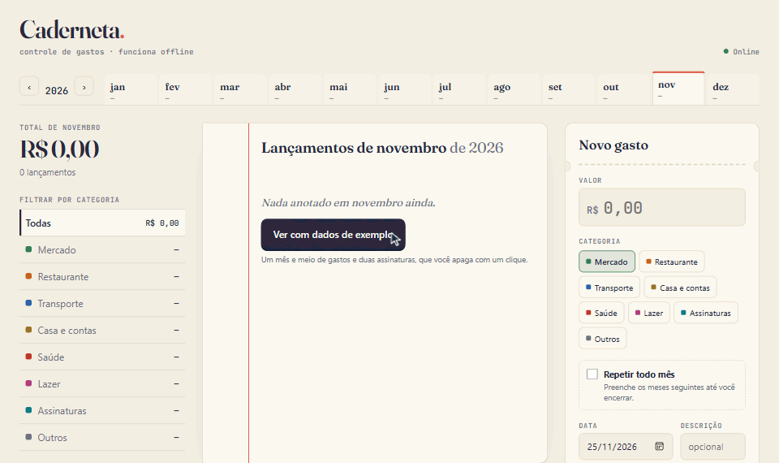

# Caderneta: controle de gastos offline

Um PWA (Progressive Web App) para anotar os gastos do mês por categoria. Ele **funciona sem internet** e pode ser instalado no celular ou no computador como um app.

**[Abrir o app → caderneta-gastos.vercel.app](https://caderneta-gastos.vercel.app)**



## O que ele faz

- Lança gastos com valor, categoria, data e descrição.
- Mostra o total do mês com a divisão por categoria e permite **filtrar por categoria**, tanto pela lista lateral quanto clicando na etiqueta de um lançamento.
- Organiza os lançamentos por dia, com o subtotal de cada dia, e tem abas de janeiro a dezembro com o total de cada mês.
- Tem **orçamento por categoria**: você define um limite por mês, e uma barra mostra quanto já foi. Ela muda de cor a partir de 80% e de novo quando passa do limite, dizendo quanto falta ou quanto passou.
- **Exporta o mês em CSV** e faz **backup e restauração** num arquivo, para os dados não ficarem presos a um aparelho.
- Tem **cobranças recorrentes**: ao anotar com "Repetir todo mês" (ideal para a categoria Assinaturas), os meses seguintes se preenchem sozinhos e aparecem como previsão. "Pular mês" pausa só aquele mês e pode ser desfeito. "Cancelar" pede confirmação na própria página, explicando quais meses ficam e quais saem: se a cobrança do mês já caiu, ela fica no histórico. O cancelamento também pode ser desfeito.
- Abre e funciona **offline**: um service worker guarda o app inteiro no aparelho.
- É instalável: tem manifest, ícones e um botão "Instalar app" quando o navegador oferece.
- Tem layout próprio para celular. Os filtros viram uma fileira de fichas, as abas rolam até o mês atual e o formulário abre como um painel que sobe da parte de baixo da tela, pelo botão "+ Anotar gasto".
- Tem o botão **"Ver com dados de exemplo"**: quem abre pela primeira vez vê um mês e meio de gastos e duas assinaturas, e apaga tudo com um clique sem perder o que anotou por cima.
- Mostra quando você está online ou offline.

## Stack

- React 19 + Vite, em JavaScript
- vite-plugin-pwa (Workbox) para o service worker e o manifest
- Vitest para os testes
- CSS puro. As fontes (Fraunces e JetBrains Mono) são servidas pelo próprio app e ficam guardadas pelo service worker, então aparecem também offline

## Design

Em vez do visual padrão de app de finanças (cartões arredondados, roxo, gráfico de pizza), a interface segue o nome: uma **caderneta**.

- **Folha pautada:** linhas de 40px com uma margem vermelha. Cada lançamento cai exatamente sobre uma pauta, e o dia fica escrito na margem.
- **Valores:** em fonte monoespaçada, ligados à descrição por uma linha pontilhada, como num livro-caixa.
- **Detalhes de papel:** as abas dos meses lembram divisórias de caderno, o formulário tem cara de comprovante e passar o mouse num lançamento acende um marca-texto.

## Rodando

```bash
npm install
npm run dev       # desenvolvimento
npm test          # testes
npm run build && npm run preview   # versão de produção, com o service worker ativo
```

Para testar o modo offline: rode o `preview`, abra o app uma vez, pare o servidor e recarregue a página. O app abre normalmente.

## Decisões técnicas

- **Valores em centavos (inteiros).** `0,1 + 0,2` em ponto flutuante dá `0,30000000000000004`; somando centavos inteiros, o total nunca erra.
- **Data no fuso do aparelho.** `toISOString()` usa UTC, e um gasto lançado às 22h no Brasil cairia no dia seguinte. O teste cobre esse caso.
- **Entrada no formato brasileiro.** "1.234,56", "12,5" e "R$ 30" são lidos corretamente (veja `src/gastos.test.js`).
- **Backup tratado como dado de fora.** Na restauração, cada campo é validado e só os campos conhecidos são copiados, o que deixa de fora coisas como `__proto__`. Um item estragado recusa o arquivo inteiro, e nada é substituído antes da confirmação.
- **CSV pronto para o Excel brasileiro.** Usa `;` entre colunas, vírgula nos centavos e BOM para os acentos. Textos que começam com `=`, `+`, `-` ou `@` são neutralizados, para não virarem fórmula (injeção de CSV).
- **Recorrência guardada como regra, não como cópias.** A cobrança é salva uma vez só (valor, dia, mês de início, mês de fim e meses pulados), e os lançamentos de cada mês são gerados na hora de mostrar. Assim não há data final arbitrária, encerrar é só gravar o mês de fim, e o dia 31 vira 30 ou 28 nos meses mais curtos.
- **localStorage para os dados:** é simples e suficiente para dezenas de milhares de gastos. A próxima etapa é sincronizar entre aparelhos (ex.: Supabase), e aí trocar por IndexedDB.

## Estrutura

```
src/gastos.js       regras: ler valor, datas, resumo do mês (sem React)
src/gastos.test.js  testes
src/App.jsx         interface
src/index.css       estilos (tema claro e escuro)
vite.config.js      configuração do PWA (manifest e service worker)
```
